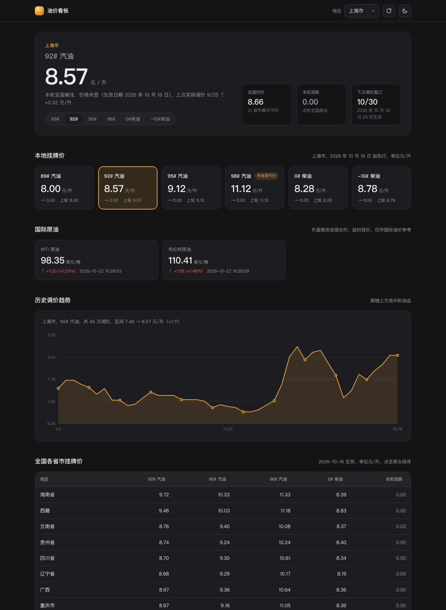

# 全国油价看板

一个开源的全国成品油挂牌价看板。纯静态 HTML + CSS + JS，零依赖零构建，下载下来直接打开就能用。

**在线体验：** <https://cooperzhuang.github.io/china-oil-price-dashboard/>



## 快速开始

```bash
git clone https://github.com/CooperZhuang/china-oil-price-dashboard.git
cd china-oil-price-dashboard

# 方式一：直接开文件（数据接口允许跨域，file:// 也能取数）
open index.html

# 方式二：起个本地静态服务（推荐，行为和线上一致）
node serve.mjs          # 默认 http://127.0.0.1:4180/
node serve.mjs 8080     # 换端口
```

只要 Node 18+（用了内置 `fetch` 和 `AbortSignal.timeout`），不需要 `npm install`。

也可以直接部署到 GitHub Pages：仓库本身就是纯静态站点，把 `main` 分支的根目录设为发布目录即可（本仓库已开启 Pages）。

## 功能

| 区块 | 说明 |
| --- | --- |
| 主数据区 | 当前地区的油价大字、全国均价、本轮涨跌、下次调价窗口 |
| 油品切换 | 主价格下方的切换器，89# / 92# / 95# / 98# 汽油与 0# / -10# 柴油。**主价格、全国均价、本轮涨跌、趋势图、表格涨跌列全部跟随切换**；下面的油品卡也可以直接点 |
| 本地挂牌价 | 六个油品各自的现价、上一轮价格、涨跌额，当前选中的高亮 |
| 历史调价趋势 | 内联 SVG 折线图，跟随当前选中的油品，鼠标悬停看每次调价的明细 |
| 全国各省市挂牌价 | 31 个省市自治区完整表格，点表头排序（地区按拼音序） |
| 地区切换 | 首次访问默认**上海市**，之后自动记住**上次看的**那个地区（存在 localStorage），顶栏下拉随时可切，也支持 `?region=浙江` 指定 |
| 国际原油 | WTI 与布伦特原油的最新价、涨跌额与涨跌幅，延时报价 |
| 亮暗主题 | 跟随系统，也可手动切亮/暗，选择记在 localStorage |

状态处理：加载用骨架屏；接口失败给出错误面板和「重试」；还提供「使用本地快照」按钮，断网也能看最近一次抓取的数据。

## 数据来源

三个公开接口，都开放 CORS，浏览器可直连，**不需要后端代理**。

### 1. 各省市调价表（主源）

```
GET https://datacenter.cngold.org/city_oil/all_price_by_year/
```

```jsonc
{
  "returnCode": 0,
  "data": [{
    "regionId": 310000, "regionName": "上海市", "date": "2026-10-16",
    "n89": 8.00, "n89Change": 0.00,
    "n92": 8.57, "n92Change": 0.00,
    "n95": 9.12, "n95Change": 0.00,
    "n98": 11.12, "n98Change": 0.00,
    "n0": 8.28, "n0Change": 0.00,
    "n10": 8.78, "n10Change": 0.00
  }]
}
```

- 一次返回全量（31 省 × 45 个调价窗口 ≈ 1400 条），不需要分页参数
- `n92` / `n95` / `n98` / `n0` 分别是 92#、95#、98# 汽油与 0# 柴油的挂牌价（单位元/升），`*Change` 是相对上一轮的涨跌额
- `Access-Control-Allow-Origin: *`

### 2. 下次调价窗口

```
GET https://datacenter.cngold.org/city_oil/near_time/
```

`data[0].date` 是上次调价日，`data[1].date` 是下次生效日。它已经把法定假日的顺延算进去了，比自己按工作日推算准。

### 3. 国际原油

```
GET https://qt.gtimg.cn/q=hf_CL,hf_OIL
```

`hf_CL` = WTI，`hf_OIL` = 布伦特，单位美元/桶。外盘期货连续合约，延时报价。

返回的不是 JSON 而是 JS 赋值语句，字段顺序为：

```
0 最新价  1 涨跌幅(%)  2 买价  3 卖价  4 最高  5 最低  6 时间(HH:mm:ss)
7 昨收   8 开盘      9 持仓量 10 买量 11 卖量 12 日期(YYYY-MM-DD) 13 品种名
```

两个坑：

- **第 1 个字段是涨跌幅百分比，不是涨跌额**。涨跌额要用 `最新价 - 昨收` 自己算。
- 响应是 **GBK** 编码，`res.text()` 按规范永远按 UTF-8 解码会出乱名，要用 `arrayBuffer()` + `new TextDecoder('gbk')` 读。

### 「下次调价窗口」的口径

优先用 `near_time/` 给出的官方下次生效日。取不到时才退回按国家发改委调价周期（约 10 个工作日）自己推算，页面上会标明是推算值。

自己推算容易错：2026-09-25 那一轮跨了国庆假期，第 10 个工作日是 10-15 而不是自然日算出来的 10-13。

### 各源的命令行版本

`sources/` 下每个源都有独立脚本，可以单独跑来做交叉校验：

```bash
node sources/cngold-provinces.mjs    # 31 省价格 + 上次/下次调价日
node sources/tencent-crude.mjs       # WTI / 布伦特
node sources/ndrc-notices.mjs        # 发改委公告口径
node sources/xiaoxiong-fprice.mjs    # 加油站成交价 + 调价倒计时
```

零依赖，只用 Node 内置模块。`sources/NOTES.md` 是各源的实测报告和已知限制。

## 离线快照

`data/snapshot.js` 是最近一次成功抓取的全量数据，实时接口不可用时，点「使用本地快照」即可离线查看。

它用 `<script>` 引入而不是 `fetch`，因为 Chrome 会拦截 `file://` 页面发起的本地文件请求，用 script 标签则不受协议限制。

重新生成：

```bash
node -e "
const fs=require('fs');
fetch('https://datacenter.cngold.org/city_oil/all_price_by_year/')
  .then(r=>r.json())
  .then(d=>{
    const keep=['regionId','regionName','date','n89','n89Change','n92','n92Change','n95','n95Change','n98','n98Change','n0','n0Change','n10','n10Change'];
    const rows=d.data.map(r=>Object.fromEntries(keep.map(k=>[k,r[k]])));
    const body=JSON.stringify({fetchedAt:new Date().toISOString(),rows});
    fs.writeFileSync('data/snapshot.js', 'window.OIL_SNAPSHOT = '+body+';');
  });
"
```

## 自测

```bash
node serve.mjs &            # 先把服务跑起来
node tools/check.mjs        # 50 项功能自测（CDP 驱动真实浏览器）
```

覆盖：真实取数、默认地区、地区切换、表格排序、油品切换（切换器 + 点卡片两条路径）、主题切换、国际原油、刷新后恢复上次查看、接口失败时的错误态、本地快照兜底。

自测用 headless Edge，通过 CDP 驱动，需要本机装有 Edge（macOS 默认路径或用 `EDGE_PATH` 覆盖）。

开发时看效果：

```bash
node tools/shot.mjs "http://127.0.0.1:4180/" out.png 1280 1500 dark
```

## 目录

```
china-oil-price-dashboard/
├── index.html            # 页面结构
├── styles.css            # 样式（CSS 变量管理亮暗两套主题）
├── app.js                # 取数、整形、渲染、图表
├── serve.mjs             # 零依赖静态服务器
├── data/snapshot.js      # 离线快照（script 引入，file:// 下也能用）
├── tools/
│   ├── shot.mjs          # CDP 精确视口截图
│   ├── eval.mjs          # 在页面里执行表达式
│   └── check.mjs         # 功能自测
├── sources/              # 各数据源的零依赖 Node 取数脚本（服务端用）
│   ├── cngold-provinces.mjs
│   ├── tencent-crude.mjs
│   ├── xiaoxiong-fprice.mjs
│   ├── ndrc-notices.mjs
│   ├── crude-jijinhao.mjs
│   └── NOTES.md          # 各源的实测报告与坑
└── docs/screenshots/     # 效果截图
```

## 实现上的几个坑

1. **`position: sticky` 不能加在 `thead th` 上**。外层 `.table-wrap` 的 `overflow` 会成为 sticky 的滚动容器，表头会被下推一个 `top` 偏移量并压住首行。
2. **组件上的 `display` 会盖掉 `hidden` 属性**。骨架屏用了 `display: grid`，必须补一条 `[hidden] { display: none !important; }`。
3. **图表要在内容区可见之后再渲染**。SVG 按容器实际像素画（viewBox 与 CSS 像素 1:1），隐藏状态下 `clientWidth` 是 0，坐标轴文字会被压得很小。
4. **数据里的地区名后缀不统一**（上海 / 上海市 / 广西 / 广西壮族自治区），需要归一化后再匹配。
5. **`file://` 下不能用 `fetch` 读本地文件**（Chrome 直接拒绝），所以离线快照走 `<script>` 引入。
6. **腾讯行情的第 1 个字段是涨跌幅百分比，不是涨跌额**。涨跌额要用 `最新价 - 昨收` 自己算，否则会显示成「涨 1.09%」。
7. **「不调价」也是一行数据**。发改委发文「不作调整」时，31 省的 `*Change` 全是 0，直接取最新行会永远显示涨跌 0.00。页面对这种情况会标明「本轮全国搁浅」，并补出上次实际调价。
8. **公告日 ≠ 生效日**。发改委写「X 月 X 日 24 时起」等于次日 0 点生效。
9. **部分数据源会拦 `HeadlessChrome` 的 User-Agent**（返回 HTTP 666），普通浏览器 UA 则正常。无头浏览器自测时需要用 CDP `Emulation.setUserAgentOverride` 换 UA，否则会误判成接口挂了。

## 说明与致谢

本项目是一个独立实现的开源小工具。数据来自上述公开接口，版权归各数据提供方所有，此处仅作聚合展示。

特别感谢以下公开数据来源：

- [金投网 城市油价数据中心](https://datacenter.cngold.org/)：各省市调价表与调价窗口
- [腾讯财经行情](https://qt.gtimg.cn/)：国际原油期货报价
- [国家发展改革委](https://www.ndrc.gov.cn/)：成品油调价公告（权威口径，用于交叉校验）
- [小熊油耗](https://www.xiaoxiongyouhao.com/)：加油站成交价与调价倒计时（交叉校验用）

实际加油价格以各地加油站挂牌价和国家发改委公告为准。本项目按 MIT 协议开源。

## License

[MIT](LICENSE)
